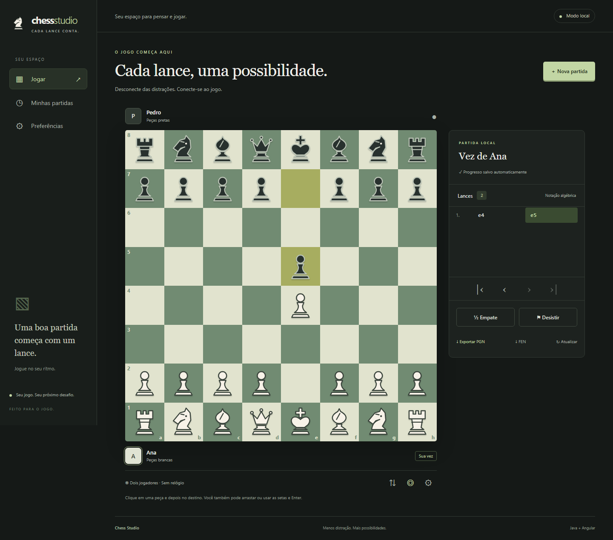

# Chess Studio

**Cada lance, uma possibilidade.** Uma aplicação de xadrez para jogar contra o computador ou com outra pessoa no mesmo dispositivo, com motor Java, API Spring Boot e frontend Angular.

O projeto evolui a implementação orientada a objetos original, que funcionava pelo terminal, para uma experiência web com partidas persistidas e interface responsiva.



## Recursos

- Tabuleiro interativo: clique, arraste ou use teclado.
- Movimentos legais, xeque, xeque-mate, roque, en passant e promoção com quatro escolhas.
- Empate por afogamento, material insuficiente, repetição e contagem de lances.
- Salvamento automático, retomada, histórico paginado e revisão lance a lance.
- Notação algébrica, exportação PGN e exportação da posição FEN.
- Temas verde musgo e madeira, dicas de movimentos e som opcional.
- **Stockfish:** dificuldades fácil, média e difícil; escolha entre brancas e pretas, com respostas automáticas.
- API documentada, controle de versão e isolamento de partidas por navegador.

## Executar localmente

Requisitos: **Java 21** e **Node.js 24.15+ (linha 24)**. O Maven Wrapper baixa o Maven automaticamente.

Em um terminal, na pasta `backend`:

```powershell
.\mvnw.cmd spring-boot:run
```

Em outro terminal, na pasta `frontend`:

```powershell
npm ci
npm start
```

Abra **http://127.0.0.1:4200**. O banco local H2 é criado em `backend/data/` e mantém as partidas após reiniciar o backend.

### Habilitar o computador

No Windows x64, dentro de `backend`, instale o Stockfish oficial antes de iniciar a API:

```powershell
.\scripts\install-stockfish.ps1
```

O instalador baixa o **Stockfish 19**, verifica o SHA-256 e mantém o executável, a licença e o código-fonte fora do versionamento, em `backend/tools/stockfish/`. Nesta máquina, a instalação já foi realizada.

Linux: instale `stockfish` pelo gerenciador de pacotes. Em qualquer sistema, também é possível definir `STOCKFISH_PATH` com o caminho completo do executável. No Docker, o motor é instalado na imagem automaticamente.

Na tela inicial, escolha **Contra o computador**, seu nome, cor e dificuldade. Jogando de pretas, o Stockfish faz o primeiro lance e o tabuleiro é invertido automaticamente.

Linux/macOS: use `bash mvnw spring-boot:run` dentro de `backend`.

## Docker

Com o Docker Engine ativo, copie `.env.example` para `.env`, ajuste a senha local e execute na raiz:

```sh
docker compose up -d --build --wait
```

Abra **http://localhost:8088**. Esse modo usa **PostgreSQL**, Spring Boot e Nginx em containers, com volume persistente para o banco.

## Desenvolvimento e testes

```powershell
# Dentro de backend
.\mvnw.cmd verify

# Inclui integração com o executável real instalado
.\mvnw.cmd verify -Pstockfish

# Dentro de frontend
npm run build
npx playwright install chromium
npm run test:e2e
```

Os testes de navegador iniciam a API e o Angular automaticamente. Antes deles, gere o JAR com `mvnw verify`. A suíte usa um banco em memória quando inicia sua própria API.

## Documentação

- [Guia de instalação, uso e configuração](guia-do-projeto.md)
- [Arquitetura, contratos e manutenção](documentacao-opencode.md)
- Swagger local: **http://127.0.0.1:8080/swagger-ui/index.html**
- OpenAPI: **http://127.0.0.1:8080/v3/api-docs**
- Health check: **http://127.0.0.1:8080/actuator/health**

## Próximas evoluções

Partidas online por convite, relógios e contas com estatísticas são próximas etapas. A versão atual oferece **jogo contra Stockfish e jogo local entre duas pessoas**, sem login ou matchmaking.

## Licença

Consulte [LICENSE](LICENSE).

Stockfish é um componente externo sob GPLv3. Consulte [avisos de terceiros](THIRD_PARTY_NOTICES.md).
